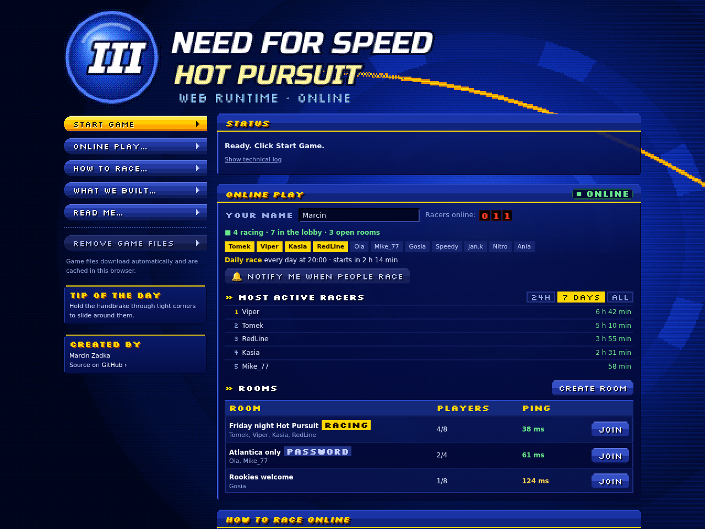
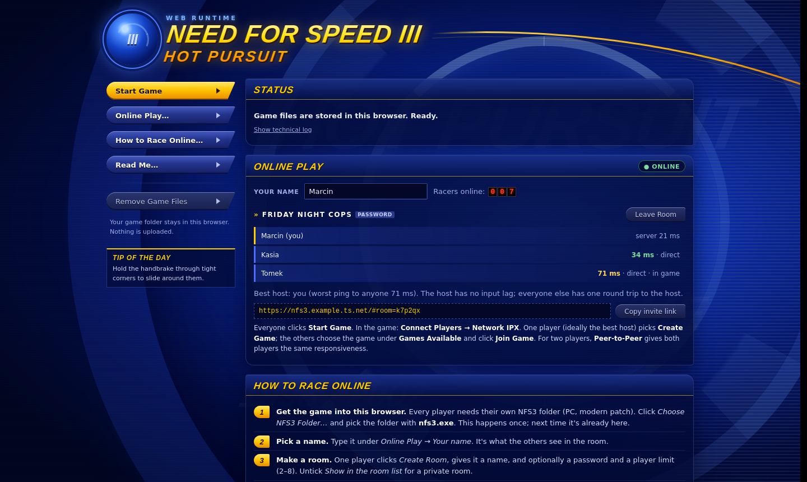
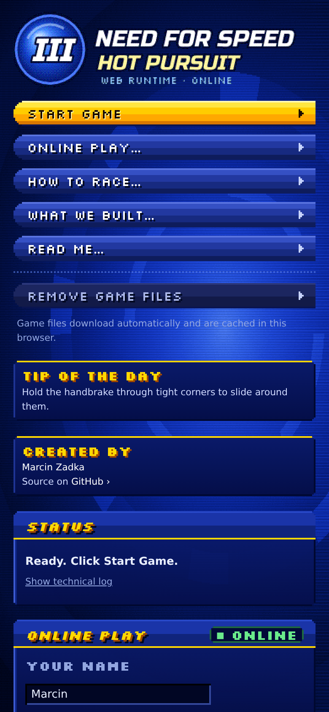
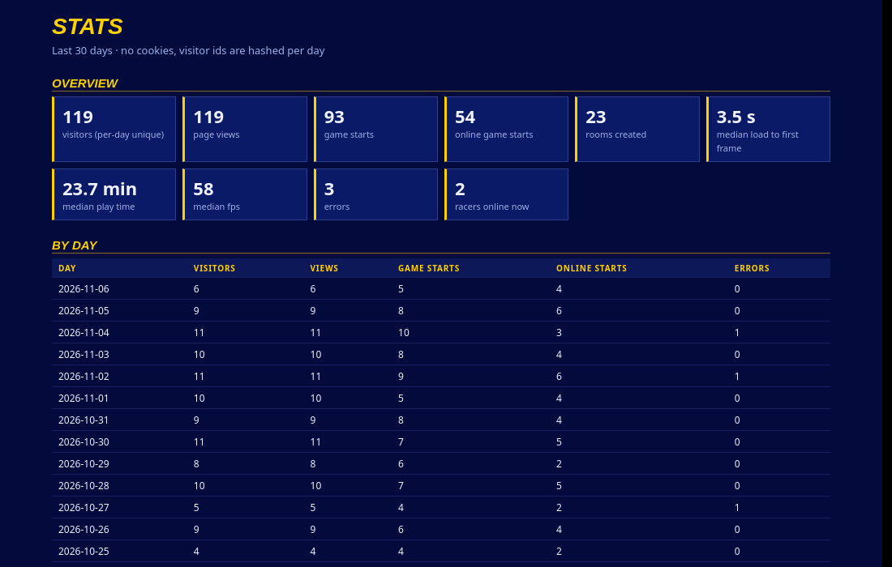
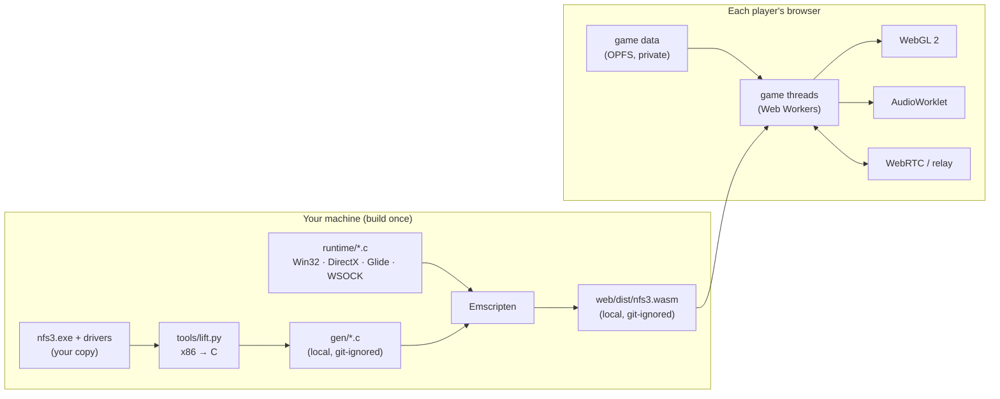

<div align="center">

# NFS3 Web

**Need for Speed III: Hot Pursuit, recompiled to run in your browser, with online multiplayer.**

Open the page, download the game files automatically, and race your friends.




</div>

---

## What is this?

NFS3 Web takes the original 1998 PC game, specifically the **modern patch** of *Need for Speed III: Hot
Pursuit*, and turns it into something a browser can run. It doesn't emulate a PC, and it isn't a
remake. It **statically recompiles** the game's own x86 code into C and then into WebAssembly, so it
runs the real game logic, physics and AI. Windows, DirectX, the Voodoo2 graphics card and the
network stack are replaced by a small runtime written for the web.

- 🏎️ **The real game.** The original code runs, recompiled, not reimplemented.
- 🎮 **GPU rendering.** The game's Voodoo2 (Glide 3) path goes straight to WebGL 2 at a sharp integer scale.
- 🌐 **Online play in the browser.** Up to 8 racers per room, direct browser-to-browser
  connections (WebRTC) with a relay fallback, room browser, passwords and invite links.
- 🌍 **Hosted game files.** The server supplies the game files automatically. Each
  browser downloads them once and caches them in private storage.
- 💾 **No install.** After the first download, Start is one click.

## The original game, and what we added

NFS3 Web is **not a remake and not a re-tuned version**. The game you drive is the original:

| Untouched: the real NFS3 | Added by this project |
|---|---|
| **Handling and physics.** Every car drives exactly like the PC original. The game's own code runs, recompiled, not rewritten or re-tuned. | **Static recompilation.** x86 machine code is translated to C and then WebAssembly, so it runs in the browser without a PC emulator. |
| **Cars, tracks, AI, police.** The original hosted game data, and the original opponent and Hot Pursuit logic. | **Voodoo2 on your GPU.** The 3dfx Glide 3 graphics path is redrawn with WebGL 2: Voodoo color combiners, W-buffer depth and fog, sharp integer scaling. |
| **Music and sound.** The original soundtrack and effects through the game's own sound engine (`eacsnd.dll`). | **Internet multiplayer.** The game's LAN (IPX) mode now works over the internet: lobby, rooms with passwords, WebRTC peer-to-peer links, redundant packets, best-host pick. |
| **Menus and modes.** Single Race, Hot Pursuit, Knockout, Tournament, Car Showcase. | **Browser integration.** OPFS game storage, AudioWorklet sound, mouse capture, frame pacing for hidden tabs, crash and stall reporting. |

**Base patch.** NFS3 Web runs the **[NFS3 Modern Patch](https://veg.by/en/projects/nfs3/)** by VEG
(Evgeny Vrublevsky): HD and widescreen support, modern-Windows fixes, faster loading and more than
200 bug fixes. The game folder on the server needs the Modern Patch installed (the English
base is what's been tested).

**Unlocked from the start.** The bonus cars (El Niño, Mercedes CLK GTR, Jaguar XJR-15, the
Pursuit Lamborghini Diablo SV and Pursuit El Niño) and the bonus track Empire City are there
from the first race, set in the game's own "awarded" flags (`runtime/game.c`; `RT_LOCKED=1`
keeps the original locks). Gamepads and wheels work as DirectInput joysticks.

**Our runtime fixes.** A few things the game expects from Windows had to be emulated precisely
before it ran correctly, for example:
- the `NUL` device that the car screen opens;
- `WaitForMultipleObjects` semantics, whose bug caused an occasional start-up hang;
- socket close waking blocked readers, which froze race starts;
- the Glide `grGet` query IDs.

These fixes live in the runtime, not in the game's code or data.

## Screenshots

| Room page before the race | On a phone |
|---|---|
|  |  |

<details>
<summary>Built-in stats page (sample data)</summary>



</details>

> Screenshots show only this project's own pages. In-game footage is left out on purpose: the
> game's graphics belong to EA.

## How it works



1. **Lifting.** `tools/lift.py` disassembles `nfs3.exe`, the Voodoo2 driver and the sound DLL with
   Capstone. Every guest function becomes a C function, with guest registers promoted to locals
   so the C compiler can optimise them.
2. **Runtime.** `runtime/` reimplements the Windows APIs the game imports (files, threads, timers,
   windows, input), plus DirectDraw, DirectSound, DirectInput, **Glide 3** (recorded per frame and
   replayed by a WebGL 2 renderer with an uber-shader for the Voodoo combiners, W-buffer depth and
   fog) and **WSOCK32** (IPX sockets on a virtual LAN).
3. **Browser.** Emscripten builds everything with threads (`SharedArrayBuffer`). The game's
   files are read from the Origin Private File System, frames are drawn on the page's animation
   frame, and audio goes through an AudioWorklet.

More detail, including the binary analysis and debugging notes, is in [ARCHITECTURE.md](ARCHITECTURE.md).

## Online play

NFS3's own netcode is a host-relayed input lockstep at 32 Hz, built for the game's LAN mode.
NFS3 Web makes a **room** on the server look like a LAN to the game:

- Every player in a room gets a virtual IPX network address. The game's "Games Available"
  browser finds the host automatically, so nobody types an IP address.
- Browsers connect **directly to each other** with WebRTC data channels. They're unordered and never
  retransmit, and every message also carries the previous two packets, so a lost packet is
  recovered with the next one about 31 ms later. Peers that can't connect directly are relayed
  by the server.
- The lobby shows each player's ping and recommends the **best host**: the host's car reacts
  instantly, and everyone else waits one round trip to the host.
- Your lobby name is also your name in the game (up to 10 characters), and a room only takes
  players on the same build, since different builds would desync in a race.
- The start page shows who is online and racing, the most active racers, the daily race, and
  a **Notify me** button (Web Push: when someone opens a room, and for the daily race).
- `?networker=1` (remembered; `?networker=0` turns it off) moves relayed packets into a Web
  Worker with its own socket, so they never wait for the page's main thread. Direct WebRTC
  links stay on the main thread (Chrome can't move them to a worker).

**Racing with friends:**

1. Everyone opens the page and waits for the automatic game download.
2. One player clicks **Create Room** (name, optional password, 2–8 players) and shares the invite link.
3. Everyone clicks **Start Game**.
4. The best host goes to *Connect Players → Network IPX → Create Game* (choose *Peer-to-Peer* for two players).
5. The others pick the game under *Games Available* and click *Join Game*.

## Getting started

### What the host needs

- **A copy of NFS3: Hot Pursuit for PC with the modern patch.** The folder with `nfs3.exe`,
  `fedata/`, `gamedata/` and `drivers/`. The build is checked against the exe's SHA-256 (see
  `ARCHITECTURE.md`).
- **A Linux build machine** with `clang`, `python3`, SDL2 and Mesa (GLES/EGL) for the native build, and
  [Emscripten](https://emscripten.org/) for the web build.
- **Node.js 18+** for the dev server and lobby (no npm packages needed).
- **A recent Chrome, Edge, Firefox or Safari** with WebGL 2 for playing.

### Build

```sh
git clone https://github.com/mrz944/nfs3-web.git && cd nfs3-web

# Python tools for the lifter
python3 -m venv .venv && .venv/bin/pip install capstone pefile

# copy your game folder to ./game (never modify your original install)
cp -r "/path/to/Need for Speed III" game

./build.sh game        # lift the game + native Linux build (debugging, headless tests)
./build-web.sh game    # browser build → web/dist/nfs3.{js,wasm}
```

### Run

```sh
node web/serve.mjs 8080 --game game                 # http://localhost:8080/
node web/serve.mjs 8080 --game game --tailscale     # optional tailnet-only hosting
```

Open the page, wait for the game files to download, then click **Start Game**.
Players do not need a local game copy. The first visit downloads about 442 MB; later visits use the browser cache.
Keyboard controls are the original ones. Click the picture to capture the mouse, and press Esc to release it.

> The game files can also come from Cloudflare R2 or any CDN with CORS instead of your
> machine: `node tools/pack-game.mjs game` makes a resumable gzip pack (347 MB), and
> `web/game-source.json` points the page at it. See [R2 hosting](docs/r2.md).
>
> Public hosting uses Cloudflare Tunnel: `https://nfs3.xyz` forwards to `http://127.0.0.1:8080`.
> See [Cloudflare setup](docs/cloudflare.md). Both the game server and `cloudflared` must stay running.
> The local server binds only to loopback; no inbound router ports are needed.

`serve.mjs` options:

| Option | What it does |
|---|---|
| `--tailscale [port]` | publish over HTTPS on your tailnet (default port 10000), removed again on exit |
| `--game DIR` | serve this game folder for automatic download into each browser (no folder picker), including through Funnel |
| `--funnel [port]` | publish the page, game files and `web/dist/` through Tailscale Funnel, open to everyone. Default public port 443 (no port in the URL), forwarding to the local server port; supported ports 443, 8443 or 10000 |
| `--daily HH:MM` | a daily race at that time (server clock): countdown on the start page, push notifications 10 minutes before and at the start |
| `--relay-tcp PORT\|PATH` | lobby endpoint for native test builds (`RT_NET=…`) |

The server also collects **page logs** (`build/clientlogs/`) and **cookie-free analytics**
(`build/analytics/`, summary at `/__stats`). Both stay on your machine.

## Project layout

```
tools/        lifter (lift.py), PE parser, profiler, test helpers
runtime/      Win32 / DirectX / Glide / WSOCK runtime (C), GPU renderer
web/          page (index.html, main.js), lobby + relay (relay.mjs, net.js),
              dev server (serve.mjs), analytics (analytics.mjs)
docs/         screenshots
build.sh      lift + native build          build-web.sh   Emscripten build
gen/ build/ web/dist/ game/               local only, never committed
```

## Native build and debugging

The native Linux build runs the same recompiled game in a window or headless, which makes most
bugs much easier to chase than in a browser.

| Variable | Purpose |
|---|---|
| `RT_HEADLESS=1 RT_DUMP=N` | no window, write every Nth frame to `build/frames/` |
| `RT_INPUT="ms:KEY,ms:CLICK@x;y,…"` | scripted keyboard and mouse input |
| `RT_VERBOSE=1..3` · `RT_TRACE=addr,…` | runtime log · trace lifted functions |
| `RT_PROF=file` | sampling profiler (`tools/prof.py`) |
| `RT_FPS_LOG=1` | log frames per second |
| `RT_TICK_MS=15.625` · `RT_HEARTBEAT_US=2900` | timed waits wake only on such ticks (like a browser on Windows) · the audio worklet's heartbeat |
| `RT_NET=unix:PATH RT_ROOM=… RT_NAME=…` | join an online room natively |
| `RT_NET_TRACE` · `RT_NET_STATS` · `RT_NET_LOSS=%` · `RT_NET_DELAY=ms` | packet trace, per-second stats, simulated loss and latency |
| `RT_NETSYNC=0` · `RT_CARLOG=ms` | online without the smoother play · log the cars' positions |
| `RT_MEMDUMP=s:n:frames` | guest memory snapshots to `build/mem/` |
| `tools/audiosim.sh`, then `RT_WAV=f RT_SIM_DRIFT=x build/nfs3sim` | the browser's audio path natively, recorded to a WAV (sound card off by x, e.g. -0.0003); `RT_RESYNC_LOG` logs mixer jumps |

`tools/nettest.sh` runs two headless instances in the same room for multiplayer tests.

## Status

- ✅ Menus, car showcase, single races, Hot Pursuit, GPU rendering, sound, keyboard and mouse
- ✅ Online: lobby, rooms with passwords, 2-player races tested across browsers
- 🚧 Next: rollback (prediction) netcode so clients have no input lag either; wider browser testing

## Credits

Made by **[Marcin Zadka](https://github.com/mrz944)**.

- The approach follows [nfsu2-web](https://github.com/th0mk/nfsu2-web), which did the same for *NFS Underground 2*.
- [NFS3 Modern Patch](https://veg.by/en/projects/nfs3/) by VEG is the patched game this project runs.
- [OpenNFS](https://github.com/OpenNFS/OpenNFS) was a reference for the game's data formats.
- [Capstone](https://www.capstone-engine.org/) and [Emscripten](https://emscripten.org/) make this possible.
- Site fonts: [Silkscreen](https://github.com/googlefonts/silkscreen) and [Russo One](https://fonts.google.com/specimen/Russo+One), both under the SIL Open Font License (`web/fonts/`).

*Need for Speed* and *Hot Pursuit* are trademarks of Electronic Arts. This is an unofficial fan
project, not affiliated with or endorsed by EA. Generated builds and game assets remain
git-ignored; the running server supplies them to players from the configured game folder.
